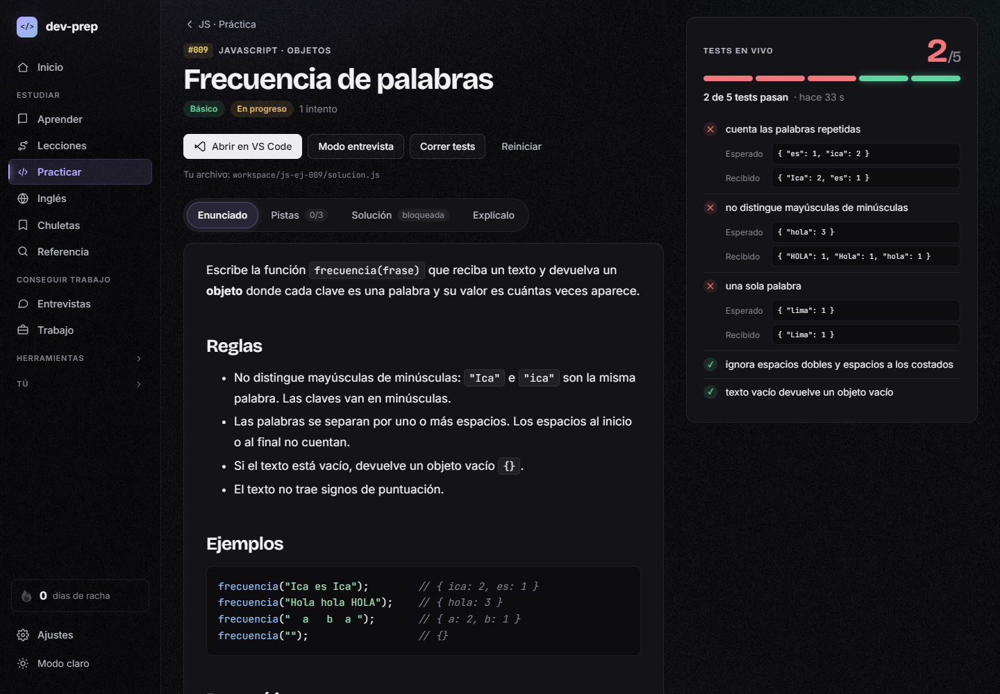
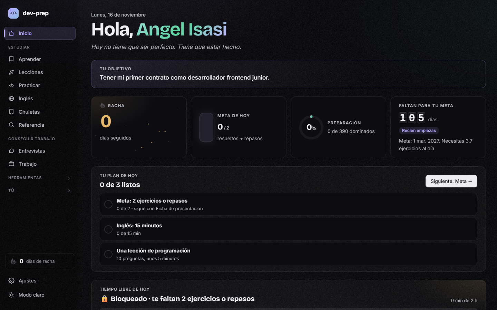
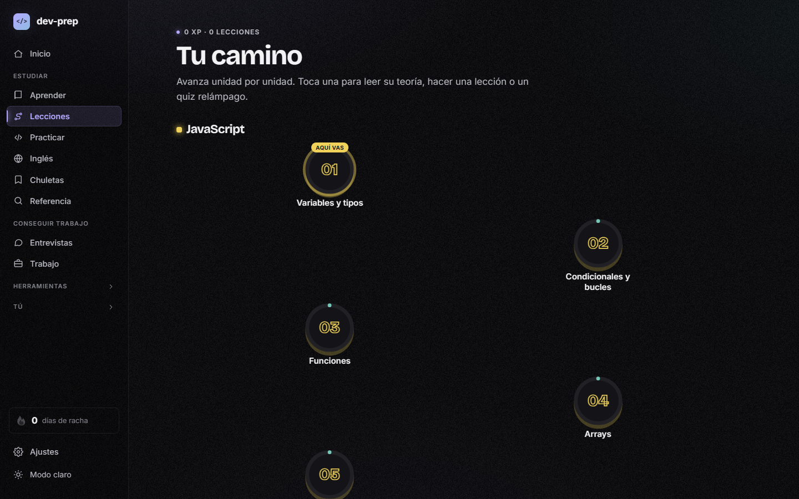
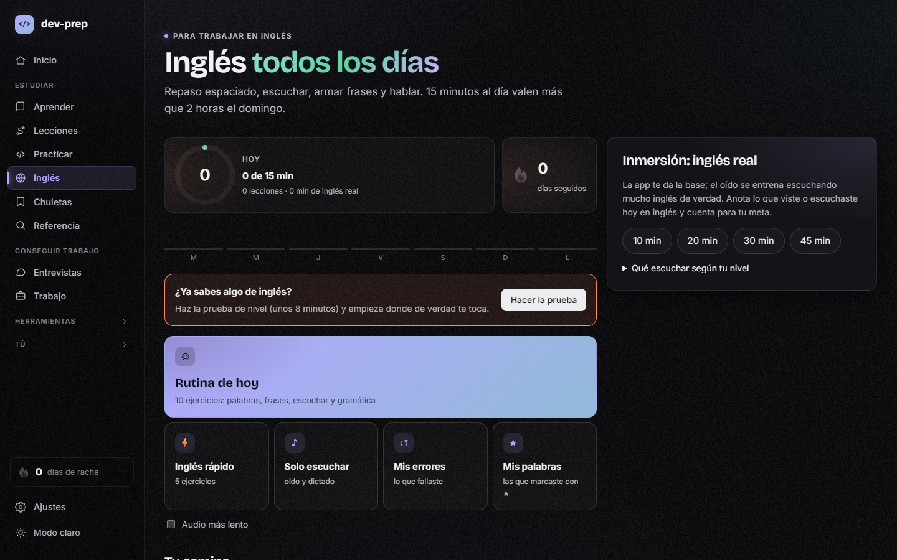
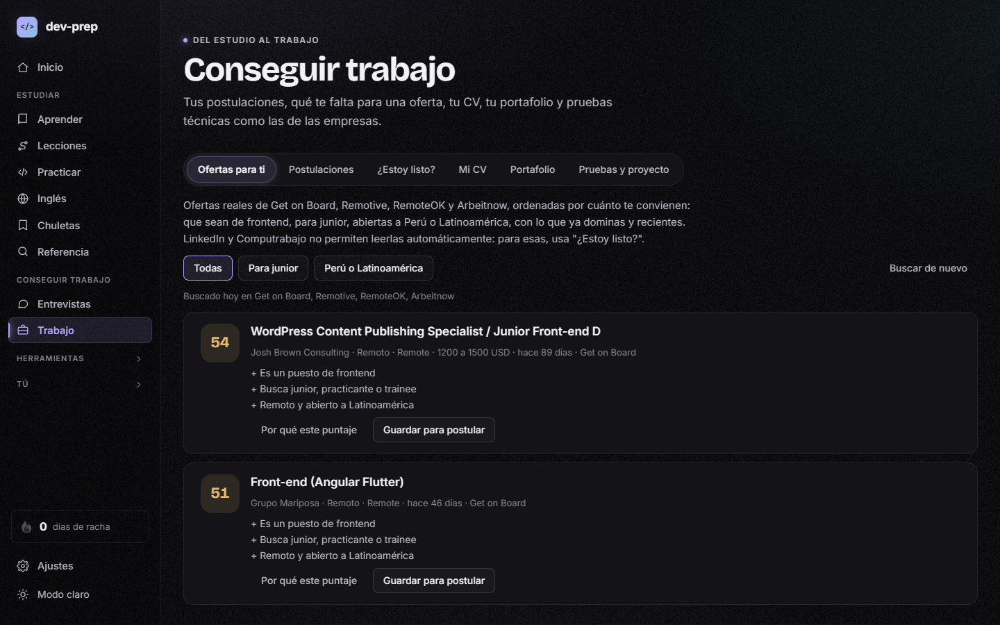
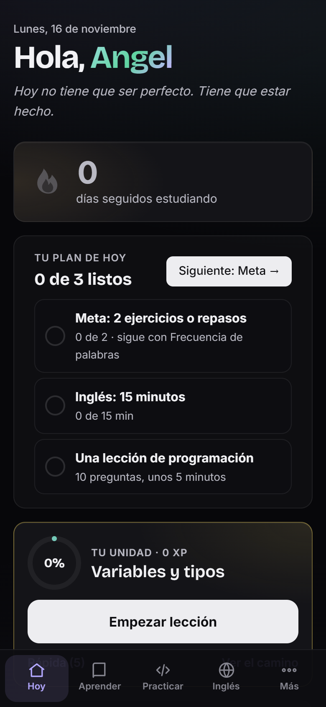

# dev-prep

App para prepararme como desarrollador frontend junior: un "LeetCode personal" en español que funciona sin internet, en la laptop y en el celular.

Programas en VS Code, guardas con `Ctrl + S` y la app muestra al instante qué tests pasan y cuáles no, con lo que se esperaba y lo que devolvió tu código. En el celular estudias con lecciones cortas, y el progreso de los dos se une solo cuando hay internet.

**Stack:** React 19, Vite, Express 5, Vitest, PWA con service worker, AWS Lambda y DynamoDB (CloudFormation), Vercel.

**En números:** 390 ejercicios con tests (JavaScript, algoritmos, React, TypeScript, Node y SQL), 35 temas de teoría, 152 preguntas de entrevista, inglés en 3 etapas y 334 tests de la propia app.

**Versión web:** [dev-prep.angel-isasi.com](https://dev-prep.angel-isasi.com) (el progreso de cada visitante queda solo en su navegador).



| Inicio | Lecciones | Inglés |
|---|---|---|
|  |  |  |

| Conseguir trabajo | Celular |
|---|---|
|  |  |

## In English

dev-prep is a personal, offline-first practice app I use every day to prepare for my first frontend developer job. You write code in VS Code; every time you save, a Vitest watcher re-runs the exercise tests and the app shows each case live (expected vs. received) through Server-Sent Events. It includes 390 exercises (JavaScript, algorithms, React, TypeScript, Node and SQL), spaced repetition, interview simulations, English lessons and progress tracking with daily goals and streaks.

- **Stack:** React 19, Vite, Express 5, Vitest, installable PWA with a service worker, AWS Lambda + DynamoDB (CloudFormation), Vercel.
- **Sync:** each device stores its progress locally and uploads its own document; documents are merged record by record (latest wins, daily counters are summed), so syncing twice is harmless.
- **Push notifications:** Web Push implemented from scratch with `node:crypto` (VAPID signing and aes128gcm encryption).
- **Security:** the local server only listens on 127.0.0.1 and checks `Origin` and `Host` (DNS rebinding); the cloud requires a 256-bit token shared only through a QR code; the published site has a strict CSP verified at build time.

## Qué tiene

- **Inicio**: tu objetivo, la racha, la meta del día (con la deuda de los días que fallaste), tu porcentaje de preparación y la cuenta regresiva a tu fecha meta, con aviso de si vas atrasado.
- **Aprender**: 35 temas (JavaScript, React, TypeScript, Node y SQL), cada uno con teoría de una pantalla, ejercicios guiados y un quiz.
- **Practicar**: 390 ejercicios de JavaScript, algoritmos, React, TypeScript, Node y SQL, con filtros por tema, nivel y estado. Los de TypeScript además revisan tus tipos con `tsc` en modo estricto.
  - **Tests en vivo**: guardas en VS Code y la app muestra al instante qué pasa y qué falla, con lo esperado y lo recibido, más tu `console.log`.
  - **Errores explicados** en español y **aviso de bucle infinito**.
  - **Pistas progresivas** (3 por ejercicio) y **solución con explicación completa**, bloqueada hasta que la pidas (con penalidad si no lo resolviste).
  - **Explícalo con tus palabras** y compáralo con la respuesta modelo.
  - **Repaso espaciado**: lo que resolviste vuelve en 1, 3, 7, 14 y 30 días.
  - **Modo entrevista**: cronómetro de 20 minutos.
- **Entrevistas**: más de 150 preguntas en tarjetas (español e inglés) con lo que el entrevistador quiere escuchar, simulacro por etapas, tu pitch de 1 minuto y tus historias STAR.
- **Progreso**: calendario de actividad, avance por tema y resumen semanal.
- **Referencia**: un mini MDN offline con buscador (arrays, strings, objetos, promesas, DOM, React...).
- Modo oscuro y modo claro.

### En la versión web (dev-prep.angel-isasi.com)

Todo lo anterior más lo que sigue. En tu laptop, con dev-prep abierto (arranca solo y oculto), la web tiene además VS Code, tests en vivo y todo lo de la app local.

- **Inglés**: sección propia con 3 etapas (base A1 a A2, intermedio B1 y de trabajo B1 a B2). Lecciones con audio, armar frases, dictado, diálogos, gramática, prueba de nivel, "Mis palabras", registro de inglés real (inmersión) y meta diaria en minutos.
- **Aprender mejor**: ejercicios de depurar código roto, Lee y predice (¿qué imprime?), revisión de código, glosario para entrevistas, explícalo en 60 segundos, mapa de lo que dominas y tus errores más frecuentes con un entrenamiento de tus puntos débiles.
- **Motivación**: tiempo libre ganado para jugar (se desbloquea al cumplir tu meta, con deuda si te pasas; el motor de la laptop mide el juego solo), niveles e insignias, sonidos suaves, plan de hoy, día salvado, mi horario y semanas de exámenes, examen semanal, modo enfoque, reto y resumen del mes, diario de una línea y semáforo para postular.
- **Avisos**: notificaciones al celular y a la laptop a tu hora habitual si no estudiaste, última llamada para tu racha, examen del sábado y resumen del domingo (máximo 2 al día). Atajos al mantener presionado el ícono de la app.
- **Conseguir trabajo**: ofertas para ti (ofertas reales de Get on Board, Remotive, RemoteOK y Arbeitnow ordenadas por cuánto te convienen, sin IA), postulaciones con las preguntas reales que te hicieron, ¿estoy listo para esta oferta?, CV en PDF, portafolio exportable a un proyecto Vite listo para GitHub, pruebas técnicas para casa con rúbrica y proyectos guiados por etapas (uno desde cero y otro de "primer día de trabajo" con tickets sobre código ajeno). Grabadora de voz para el simulacro, el pitch y las tarjetas (los audios quedan solo en tu dispositivo).
- **Simulacro por etapas**: recursos humanos, entrevista técnica con repreguntas sobre tu ejercicio, presentación de tu proyecto ("Defiende tu proyecto", preguntas sobre el propio dev-prep) y cierre con tus preguntas; completo o por etapa, con reflexión y plan de refuerzo.
- **Practicar más**: "Escribe tú los tests" (tus tests deben atrapar versiones con errores escondidos), "Consumir APIs" (retos de React con una API que tarda o falla), Git práctico (10 situaciones reales con un repositorio de verdad que el motor prepara y revisa) y el reto de la semana con tu marca personal.
- **Progreso**: plan de la semana armado con tus puntos débiles, "cuánto avancé" (ahora contra hace 1 y 3 meses), tu día en números y la pregunta ancla al terminar de leer una teoría.
- **API de práctica**: `http://localhost:4321/api/practica` sirve productos y tareas que tardan, fallan o vienen vacíos a propósito (`?retraso=2000`, `?fallo=0.5`, `?estado=500`, `?vacio=1`). Sirve para los retos y para tus proyectos con Vite.

## Requisitos

- Windows 10 u 11
- [Node.js](https://nodejs.org) 22 o superior (versión LTS)
- [VS Code](https://code.visualstudio.com), instalado con la opción **"Agregar a PATH"** marcada (para que funcione el botón "Abrir en VS Code")

Solo la primera instalación necesita internet. Después todo funciona sin conexión.

## Instalación

```
git clone https://github.com/Angel-Isasi/dev-prep.git
cd dev-prep
npm install
```

## Uso diario

**Acceso directo (recomendado).** Créalo una sola vez con:

```
npm run acceso-directo
```

Aparece **dev-prep** en tu escritorio. Con doble clic la app abre en el navegador en unos segundos, sin ventana negra. Si ya estaba abierta una versión anterior, la cierra y arranca la más reciente. Para cerrarla, usa **Cerrar dev-prep** en la barra lateral de la app.

Puedes anclarlo a Inicio o a la barra de tareas: clic derecho sobre el acceso directo.

**Solo la versión web (sin abrir nada).** Activa el arranque automático una vez:

```
npm run arranque:activar
```

Al prender la laptop, dev-prep queda corriendo oculto (unos 100 MB de memoria, casi nada de procesador) y no abre ninguna ventana. Abres https://dev-prep.angel-isasi.com y, en Ajustes, tocas **Conectar con dev-prep de esta laptop** una sola vez: la web tiene VS Code, los tests en vivo y todo lo de la app local. Para quitarlo: `npm run arranque:quitar`.

**Con ventana (para ver errores).** Doble clic en `iniciar.bat`: muestra la consola del servidor. Ciérrala o presiona `Ctrl + C` para apagar la app.

### Cómo se practica un ejercicio

1. Entra a **Practicar** y elige un ejercicio.
2. Pulsa **Empezar en VS Code**: se crea tu copia en `workspace/<id>/solucion.js` y VS Code la abre.
3. Programa y guarda (`Ctrl + S`). El panel **Tests en vivo** se actualiza solo.
4. Cuando todos los tests pasan, el ejercicio queda como **resuelto**.

Si quieres empezar de cero, **Reiniciar** vuelve al archivo inicial y guarda tu versión en `workspace/.respaldos/`.

## Dónde se guardan tus cosas

| Carpeta | Qué contiene |
|---|---|
| `workspace/` | Tu código de cada ejercicio |
| `data/progreso.json` | Tu progreso (con una copia diaria en `data/respaldos/`) |
| `data/mis-respuestas.json` | Tu pitch y tus historias STAR |
| `data/eventos.jsonl` | Historial de lo que haces, para estadísticas futuras |
| `data/sync.json` | La dirección y el token secreto de la sincronización con AWS |
| `Documentos/dev-prep-git/` | Los repositorios de Git práctico (puedes borrarlos: se vuelven a crear) |
| `Documentos/portafolio/` | Los mini proyectos que exportas para GitHub |
| Navegador (versión web) | Tu progreso en ese dispositivo, en su almacenamiento local |

`workspace/` y `data/` nunca se suben a Git.

## Comandos

| Comando | Para qué sirve |
|---|---|
| `npm start` | Arranca la app (igual que `iniciar.bat`, sin abrir el navegador) |
| `npm run acceso-directo` | Crea el acceso directo **dev-prep** en el escritorio |
| `npm run arranque:activar` | dev-prep arranca oculto al iniciar Windows, para usar solo la versión web (`arranque:quitar` lo deshace) |
| `npm run dev` | Modo desarrollo: recarga la interfaz al cambiar el código (abre `http://localhost:5173`) |
| `npm run build` | Compila la interfaz en `client/dist` |
| `npm test` | Tests de la propia app |
| `npm run validar` | Revisa que cada ejercicio esté completo, que su solución pase y que el archivo inicial falle |
| `npm run validar:aprender` | Revisa los temas de Aprender y las entradas de la Referencia |
| `npm run validar:ingles`, `validar:predice`, `validar:proyectos` | Revisan el inglés, los "¿qué imprime?" y los proyectos guiados |
| `npm run build:movil` | Compila la versión web y celular en `client/dist-movil` y verifica su CSP |
| `npm run aws:crear` | Crea o actualiza la sincronización en AWS (Lambda, URL y tabla) |
| `npm run aws:estado` | Muestra si la sincronización responde |
| `npm run aws:rotar` | Cambia el token secreto (luego vuelve a vincular el celular) |
| `npm run aws:borrar` | Borra todo lo de AWS, datos incluidos |

## Cómo está hecha

- **Interfaz**: React 19 + Vite, React Router, CSS Modules con variables para el tema.
- **Servidor**: Express 5. Lee los ejercicios de `content/`, guarda el progreso en JSON y abre VS Code.
- **Tests en vivo**: Vitest usado desde Node en modo watch, con un reporter propio que envía los resultados al navegador por **Server-Sent Events**.
- **Versión web y celular**: el mismo código de React compilado en modo `movil` (Vite cambia la capa de datos por una que lee JSON exportados y guarda en el navegador). Es una PWA: funciona sin internet y se instala desde Chrome.
- **Sincronización**: cada dispositivo guarda primero en sí mismo y sube su documento a una Lambda de AWS. Al bajar los de los otros, los mezcla registro por registro (`server/combinar.js`): gana lo más reciente y los días se suman, así que repetir una sincronización no daña nada.
- **Avisos**: Web Push hecho solo con `node:crypto` (firma VAPID y cifrado aes128gcm, `server/webpush.js`), enviado por la Lambda cada 30 minutos si toca.
- **Seguridad**: el servidor solo escucha en `127.0.0.1`, revisa las cabeceras `Origin` y `Host` (contra webs ajenas y DNS rebinding) y el navegador nunca envía rutas de archivos, solo el id del ejercicio. La nube exige un token de 256 bits que solo viaja en el QR, y el sitio publicado tiene una CSP estricta.

```
VS Code ──guardas──► workspace/<id>/solucion.js
                           │ (Vitest vigila la carpeta)
                           ▼
Navegador ◄──SSE──── Express ◄── reporter ◄── Vitest
    │                   │
    └── fetch /api ────►├─► content/  (ejercicios)
                        ├─► data/     (progreso)
                        └─► code      (abre VS Code)
```

| Carpeta | Qué contiene |
|---|---|
| `client/` | Interfaz en React |
| `server/` | Servidor Express, corredor de tests y progreso |
| `content/` | Ejercicios: enunciado, archivo inicial, tests, pistas, solución y explicación |
| `scripts/` | Validadores de contenido, generadores de lecciones, exportador para la web y scripts de AWS |
| `aws/` | Plantilla de CloudFormation y código de la Lambda |
| `docs/` | Plan del proyecto y tareas |

### Formato de un ejercicio

Cada ejercicio es una carpeta en `content/`. Para agregar uno no hay que tocar el código de la app:

```
content/javascript/ejercicios/009-frecuencia-de-palabras/
  meta.json        id, título, tipo (funcion o componente), tema, nivel y tags
  enunciado.md     descripción, reglas y ejemplos
  inicio.js        el archivo con el que empiezas
  tests.test.js    tests con Vitest (importan ./solucion.js)
  pistas.json      3 pistas, de la más suave a la casi respuesta
  solucion.js      solución oficial
  explicacion.md   idea clave, paso a paso, por qué funciona, errores comunes,
                   otra forma, cómo explicarlo en una entrevista y conceptos
```

Los componentes de React usan `.jsx` en vez de `.js`. Después de agregar o cambiar un ejercicio, corre `npm run validar`.

## Problemas comunes

- **"No se encontró Node.js"**: instala Node.js LTS y vuelve a abrir `iniciar.bat`.
- **"No se encontró el comando code"**: reinstala VS Code marcando "Agregar a PATH" y reinicia la PC.
- **"El puerto 4321 está ocupado"**: ya hay una ventana de dev-prep abierta; usa esa o ciérrala.
- **Los tests de React tardan la primera vez**: es normal, el primer arranque del entorno de React puede tomar varios segundos.
